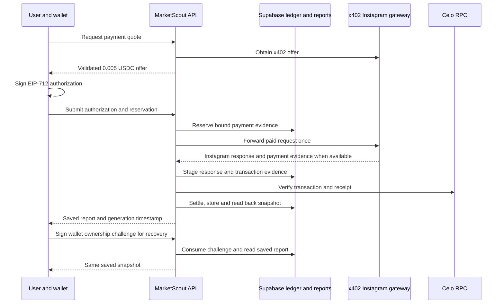

# MarketScout AI architecture

## Components

| Component | Responsibility |
| --- | --- |
| Next.js / React browser | Accept an Instagram username, display the quote, request wallet authorization and render saved reports. |
| Vercel API routes | Enforce the release scope and request validation, orchestrate the gateway request, and serve wallet-authenticated recovery. |
| Celo wallet and USDC | Sign the EIP-712 transfer authorization; the gateway's settlement transaction transfers USDC on Celo Mainnet. |
| Instagram gateway | Return the x402 offer and, after an authorized paid request, Instagram profile data and payment evidence. |
| Celo RPC | Provide transaction, canonical block and receipt evidence for settlement verification. |
| Supabase PostgreSQL | Atomically reserve payment evidence, enforce replay constraints, stage gateway results, and store reports and recovery challenges. |

This is the successful path, not a guarantee that every gateway request returns a usable response. A failure after payment can remain unresolved. Recovery can continue processing from an original staged body; it cannot reconstruct a body that was never captured.

## Payment and persistence

The deployed quote and execute routes use a default-closed controlled gate. When enabled for a test, the server requires the configured payer, lowercase Instagram username and reservation UUID. The request and signature are checked before an atomic reservation, which binds authorization metadata and username. The gateway relay has a 165-second timeout; the execute route requests a 300-second function budget. It does not automatically resend a paid request.

When a transaction hash and response are available, staging occurs before settlement verification and report generation. The verifier checks the configured chain and USDC token, the successful transaction and canonical block, authorization calldata and matching `Transfer` and `AuthorizationUsed` logs. Verified settlement and report storage are tied to the reservation. A successful execute response requires reading back the saved report. The normalized report is a historical snapshot with its original generation time.

## Recovery and trust boundaries

The recovery route issues a random, short-lived challenge bound to the payer, reservation and request domain. It verifies the wallet's message signature and consumes the challenge before reading the saved report. A staged response may be used to finish interrupted processing without paying the gateway again. Access depends on the original wallet, server and database; recovery is not a public report URL.

The browser and wallet authorize a transfer but do not prove its settlement. The gateway supplies offchain data and may fail after payment. The application trusts configured RPC responses for chain evidence and Supabase for durable state and RPC constraints. Server credentials and Vercel configuration are administrative trust boundaries. See [security](SECURITY.md) and [controlled test evidence](submission/evidence.md).

## Source map

- `src/app/api/payment/quote/route.ts` and `execute/route.ts` — offer and execution endpoints.
- `src/lib/public-payment-readiness.ts`, `public-payment-signature.ts`, `public-payment-orchestrator.ts` — release scope, authorization and orchestration.
- `src/lib/public-payment-gateway-relay.ts`, `paid-response-store.ts`, `paid-report-store.ts` — relay, staging and saved reports.
- `src/lib/payment-onchain-verifier.ts` and `payment-evidence-verifier.ts` — chain evidence checks.
- `src/app/api/report-recovery/route.ts`, `src/app/recover/page.tsx` — wallet-authenticated recovery and dashboard.
